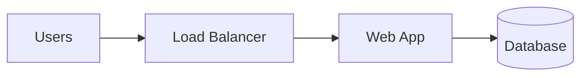

<!-- Recruiter-Friendly-README-Template | HOW-TO-GUIDE.md | Version 1.0.0 | 2026-10-20 -->

# How to Turn Your Project into a Case Study

This guide walks you through every step of turning a technical project into a GitHub page that recruiters, hiring managers, and engineers will want to read. It assumes you have never used GitHub before. If you already know how to do a step, skip ahead to the next one.

**What you will end up with:** a project page on GitHub with a README file that explains your project as a case study. A case study tells the story of a project: the problem, what you built, the choices you made, and proof that it works.

**How long it takes:** about 2 to 4 hours for your first project, not counting the time it takes to build the project itself. Your second and third projects will go much faster.

**What a finished one looks like:** before you start, look at the complete example. It shows exactly what you are working toward:
https://github.com/techric/Recruiter-Friendly-README-Template/blob/main/docs/example-case-study.md

---

## Contents

1. Words you will see in this guide
2. Before you start
3. Create your GitHub account
4. Make your own copy of the template
5. Build and test your project, and take notes
6. Upload your project files
7. Fill in the README, one section at a time
8. Turn on the automatic checks (the badge)
9. Add a description and topics
10. Check your work before you share it
11. Add the project to the portfolio site
12. Keep it up to date
13. Fixing common problems

---

## 1. Words You Will See in This Guide

You do not need to memorize these. Come back to this list whenever a word is unclear.

| Word | What it means |
|---|---|
| **GitHub** | A free website where people store, share, and work on code. |
| **Repository (repo)** | A project folder on GitHub. It holds all the files for one project. Each project gets its own repository. |
| **README** | A file named README.md. GitHub shows it automatically on the main page of a repository, so it works like the front page of your project. |
| **Markdown** | A simple way to format text using symbols. For example, a line starting with `#` becomes a heading, and text wrapped in `**two stars**` becomes **bold**. Files ending in .md use Markdown. |
| **Template** | A ready-made starting file that you copy and fill in. |
| **Placeholder** | Text in [square brackets] inside the template. You replace each one with your own information. |
| **Commit** | Saving a change on GitHub. Every commit has a short message that describes what you changed, like "Add screenshots." |
| **Main branch** | The main version of your files. In this guide, you always save your changes to the main branch. |
| **Hidden comment** | Text between `<!--` and `-->`. It does not appear on the finished page. The template uses hidden comments to hold short instructions. |
| **Workflow** | A list of steps GitHub runs for you automatically, such as checking your code every time you save a change. |
| **Badge** | A small image at the top of your README that shows whether your automatic checks passed (green) or failed (red). |
| **Terraform** | A tool that creates cloud resources (servers, networks, databases) from code files ending in .tf. The template assumes your project is built this way, but you can adjust it for other tools. |
| **Deploy** | Create your project's resources in the cloud so it actually runs. |
| **Tear down** | Delete those cloud resources so you stop paying for them. |

---

## 2. Before You Start

Make sure you have these four things:

1. **A finished project.** This guide does not teach you how to build a project. It teaches you how to present one. Only feature projects that are finished and working. A project marked "in progress" makes a portfolio look weaker, not stronger.
2. **A computer with a web browser.** Almost everything in this guide happens on the GitHub website. You only need extra software for running your own project.
3. **Access to your cloud account** (for example, AWS or Google Cloud), so you can run the project one more time to take measurements and screenshots.
4. **A way to take screenshots.** On Windows, press the Windows key, Shift, and S at the same time. On a Mac, press Shift, Command, and 4 at the same time.

---

## 3. Create Your GitHub Account

Skip this step if you already have an account.

1. Go to https://github.com/signup
2. Enter your email address and create a password.
3. Choose a username. Pick it carefully, because it appears in every link to your work (for example, github.com/your-username). Use something professional and close to your real name.
4. Follow the instructions on the screen to verify your email address.
5. Add your real name and a photo to your profile here: https://github.com/settings/profile. Recruiters look at your profile, and a real name helps them connect your work to your résumé.
6. Turn on two-factor authentication to protect your account: https://github.com/settings/security. This means GitHub will ask for a code from your phone when you sign in on a new device.

---

## 4. Make Your Own Copy of the Template

You never edit the template itself. Instead, you make a new copy of it for each project.

### Option A: Use the template button (easiest)

1. Go to the template: https://github.com/techric/Recruiter-Friendly-README-Template
2. Near the top right of the page, click the green button labeled **Use this template**, then click **Create a new repository**. If you do not see this button, use Option B below instead.
3. Fill in the form on the next page:
   - **Owner:** choose your username.
   - **Repository name:** type a short name for your project. Use lowercase letters and put hyphens between words instead of spaces. Example: `gke-observability-platform`. **Write this name down exactly as you typed it.** You will need it several times later.
   - **Description:** leave this blank for now. You will add it in Step 9.
   - **Public or Private:** choose **Public**. Recruiters cannot see private repositories.
4. Click **Create repository**. After a few seconds, your new repository opens with copies of all the template files.

### Option B: Copy the files by hand

Use this only if the **Use this template** button is missing.

1. Go to https://github.com/new
2. Type your repository name (see the naming rules in Option A), choose **Public**, check the box labeled **Add a README file**, and click **Create repository**.
3. Open the template's README in plain text: https://raw.githubusercontent.com/techric/Recruiter-Friendly-README-Template/main/README.md
4. Select all of the text (Ctrl and A on Windows, Command and A on a Mac) and copy it (Ctrl and C, or Command and C).
5. Go back to your new repository and click **README.md**.
6. Click the pencil icon near the top right of the file. Its label is **Edit this file**.
7. Select all of the text in the editor, delete it, and paste the template text in its place.
8. Click the green **Commit changes...** button, then click **Commit changes** in the box that appears.
9. Repeat the same process for these files, creating each one with **Add file**, then **Create new file**, and typing the full name, including the folder, into the name box:
   - `SECURITY.md`
   - `docs/security-checklist.md`
   - `docs/templates/infra-checks.yml`

   You can find each original file in the template repository by clicking its name and then clicking the **Raw** button.

### Clean up your copy (both options)

A few files belong to the template, not to your project. Delete them from your copy so your project stays clean:

- `CHANGELOG.md`
- `HOW-TO-GUIDE.md`
- `docs/example-case-study.md`

To delete a file:

1. Click the file's name to open it.
2. Click the three dots (**...**) near the top right of the file, then click **Delete file**.
3. Click the green **Commit changes...** button, then click **Commit changes** in the box that appears.

Then update the license file with your name:

1. Click **LICENSE**, then click the pencil icon.
2. Replace the name on the copyright line with your own name, and update the year if needed.
3. Click **Commit changes...**, then **Commit changes**.

---

## 5. Build and Test Your Project, and Take Notes

The most convincing case studies are written from notes taken while the project was actually running. Do this step **before** you write anything in the README.

1. **Deploy your project** using small, inexpensive settings. You only need it running long enough to test and take notes.
2. **Confirm it works** the way it should.
3. **While it is running, collect these five things:**
   - **Measurements.** Write down at least two numbers you measured yourself, and how you measured each one. Good examples: how fast the system responds under load, how long it takes to recover after something breaks, or how much it costs per day.
   - **Screenshots.** Take 2 or 3: one of your cloud console showing the resources you created, one of a dashboard or the working app, and one of a successful pipeline run or command. Before saving, crop out or blur anything private: account numbers, email addresses, keys, passwords, and IP addresses.
   - **A failure test.** Break one thing on purpose, such as stopping a server, and write down what happened and how long it took to recover. A real failure test is one of the most impressive things you can include.
   - **Command output.** Copy the last few lines from a successful deploy, such as `Apply complete! Resources: 12 added, 0 changed, 0 destroyed.`
   - **Your decisions.** Write down 2 to 4 important choices you made and the other options you considered.
4. **Tear down your project** so you stop paying for it. For Terraform projects, run `terraform destroy`. Then open your cloud console and confirm nothing is still running.

**Save your screenshots with simple names:** all lowercase, no spaces, such as `cluster.png`, `dashboard.png`, and `pipeline.png`.

You can copy this worksheet into a notes app and fill it in as you go:

```text
Project name:
Date tested:

Measurement 1:          How I measured it:
Measurement 2:          How I measured it:
Measurement 3:          How I measured it:

Failure test - what I broke:
What happened:
How long to recover:

Decision 1:   Options I considered:            Why I chose it:            What I gave up:
Decision 2:   Options I considered:            Why I chose it:            What I gave up:

Cost while running (per day):
Screenshots taken (file names):
```

---

## 6. Upload Your Project Files

Your code and screenshots go into specific folders in your repository:

```text
infra/              Your Terraform files
docs/screenshots/   Your screenshots
scripts/            Any helper scripts (optional)
```

### Step 6.1: Remove private files before uploading

**This is the most important rule in this guide.** Uploading files through the GitHub website does not filter out private files. Anything you upload to a public repository can be seen by anyone, and copied, within minutes.

Before uploading, remove these from the folder on your computer:

- Any file ending in `.tfstate` or `.tfstate.backup`
- The `.terraform` folder
- `terraform.tfvars`, if it contains real values. Upload a copy named `terraform.tfvars.example` with fake values instead.
- Key files, such as files ending in `.pem` or `.key`, and cloud service account key files (usually `.json`)
- Any file named `.env`

**If you upload a password or key by mistake:** deleting the file is not enough, because GitHub keeps the history of every change. Go to your cloud provider right away and cancel (revoke) that key or password, then create a new one.

### Step 6.2: Upload your code

1. Go to your repository's main page.
2. Click the **Add file** button (next to the green **Code** button), then click **Upload files**.
3. Drag your `infra` folder from your computer into the box on the page. Dragging the whole folder keeps the folder structure.
4. In the box under **Commit changes**, type a short message such as `Add Terraform code`.
5. Click the green **Commit changes** button.

### Step 6.3: Upload your screenshots

1. On your computer, create a folder named `screenshots` and put your screenshot files inside it.
2. In your repository, click the `docs` folder to open it.
3. Click **Add file**, then **Upload files**.
4. Drag your `screenshots` folder into the box. Because you are inside the `docs` folder, it will be saved as `docs/screenshots`.
5. Type a message such as `Add screenshots`, then click **Commit changes**.

---

## 7. Fill In the README, One Section at a Time

This is the main part of the work. Keep the complete example open in another browser tab while you write:
https://github.com/techric/Recruiter-Friendly-README-Template/blob/main/docs/example-case-study.md

### How to edit the README

1. On your repository's main page, click **README.md**.
2. Click the pencil icon near the top right of the file. Its label is **Edit this file**.
3. Make your changes in the editor.
4. Click the **Preview** tab at the top of the editor to see how the page will look. Click **Edit** to go back to typing.
5. When you finish a section, save your work: click the green **Commit changes...** button, type a short message such as `Fill in Summary`, and click **Commit changes**.

**Save after every section or two.** If you close the browser tab before committing, your changes may be lost.

### Rules for editing

1. **Replace the whole placeholder, including the square brackets.** For example, `[Under $X]` becomes `Under $5`, not `[Under $5]`.
2. **Hidden comments are instructions.** Text between `<!--` and `-->` does not show on the page. Read it, then either leave it or delete it. If you delete a comment, always delete both the `<!--` and the `-->`. If you delete only the `-->`, everything below it disappears from the page.
3. **Keep the version line.** The first hidden comment starts with a line like `Recruiter-Friendly-README-Template | README.md | Version 2.1.0`. Leave that line in place. It records which version of the template you used.
4. **Be careful with tables.** Tables are built from lines that start and end with the `|` symbol.
   - Keep the first row (the column names) and the second row (the one made of `|---|`). The table breaks without them.
   - Every row needs the same number of `|` symbols.
   - To add a row, copy an existing row and change the words.
   - Delete example rows you do not use.
5. **Keep the section headings.** Lines that start with `##` are section headings. Do not rename them. Reviewers, and the portfolio site, rely on this structure.
6. **Keep it short.** Most readers skim. One or two sentences per answer is usually enough.
7. **Only write what is true.** Do not claim anything you did not do or measure. Experienced reviewers can usually tell, and one exaggeration makes them doubt everything else.

### The top of the page

This part is what recruiters read. Many recruiters read nothing else, so it needs to work on its own.

**Title.** Replace `[Project Title]` with a plain, descriptive name.
- Weak: `My Cool Cloud Project`
- Strong: `Observability Platform on GKE`

**One-line summary.** The line that starts with `>` says what the project does and who it is for, in one sentence.
- Weak: `A project about monitoring.`
- Strong: `Centralized logs, metrics, and traces for a multi-service app on GKE, built with Terraform and the Grafana LGTM stack.`

**Badge.** In the line that starts with `[![Infrastructure checks]`, replace `[repo-name]` with your repository name **in both places**. Type it exactly as you wrote it down in Step 4, because capital letters matter. The badge will not show correctly until you finish Step 8.

**Highlight.** Your single strongest result, with a number, stated as something you actually measured.
- Weak: `Built a highly scalable, resilient platform.`
- Strong: `Recovered from a full node failure in 4 minutes with no lost data, confirmed by a controlled failure test.`

**The table under the highlight.**
- **Stack:** list the cloud services and tools you used, by their real names. Recruiters search for these exact words.
- **Scope:** pick exactly one of the three options and delete the other two. Be honest. Lab projects are respected when they are labeled as labs. Presenting a lab project as company production work damages trust.
- **My role:** what you personally did. If you worked alone, say so.
- **Last tested:** the month and year you last ran the project, such as `October 2026`.

### Section 1: Summary

**What it is for:** the whole project in three short answers.
**Who reads it:** hiring managers and recruiters.

- **Problem:** what was wrong or missing, and why it mattered.
- **Solution:** what you built.
- **Result:** what changed, with a number and how you measured it.

Example:
- Weak result: `It worked well.`
- Strong result: `Finding the failing service during an outage dropped from about 30 minutes to under 5, measured across 10 practice outages.`

### Section 2: Requirements and Constraints

**What it is for:** the goals and limits your project had to meet. Your decisions in Section 4 only make sense when readers know these.
**Who reads it:** hiring managers.

List 3 to 5 real requirements. Even a home lab has them, such as a budget. For each one, write the target in the right-hand column.

- Weak: `Fast | Yes`
- Strong: `Response time under normal load | Under 300 ms at the 95th percentile`

### Section 3: Architecture

**What it is for:** a picture of how the parts of your project connect.
**Who reads it:** everyone, especially technical reviewers.

The template uses **Mermaid**, a way to draw diagrams by typing text. GitHub turns the text into a picture automatically, and so does the portfolio site.

Here is a small example:

````text

````

How to write your own:

1. The diagram must start with a line that says ` ```mermaid ` and end with a line that says ` ``` `. Keep both lines exactly as they are in the template.
2. The line `flowchart LR` draws the diagram from left to right. Use `flowchart TD` to draw it from top to bottom instead.
3. Each box has a short ID and a label in square brackets. In `lb[Load Balancer]`, the ID is `lb` and the box shows "Load Balancer."
4. Draw an arrow with `-->`. For example, `lb --> app` draws an arrow from the load balancer to the app.
5. To refer to the same box again, use its ID again. You only write the label the first time.
6. To make a box look like a database, use `[( )]`, as in `db[(Database)]`.
7. To put a word on an arrow, write it between `|` symbols: `app -->|HTTPS| api`.
8. If a label contains parentheses or other symbols, put the label in quotation marks: `lb["Load Balancer (public)"]`.
9. Click **Preview** to check your diagram. If you see an error instead of a picture, look for a typo. You can also test diagrams at https://mermaid.live, which shows the picture as you type.

Under the diagram, fill in **How it works** with 3 to 5 steps that follow the arrows, in plain words.

If you would rather use an image you drew in another program, the hidden comment in this section explains how to swap it in.

### Section 4: Key Decisions and Trade-offs

**What it is for:** showing how you think. This is the section senior reviewers read most carefully.
**Who reads it:** hiring managers and technical reviewers.

Pick 2 to 4 decisions that shaped your project. For each one, fill in a row:

- **Decision:** what you had to decide.
- **Options considered:** the choices you seriously looked at.
- **Choice and why:** what you picked and the main reason. Connect it to a requirement from Section 2 when you can.
- **Trade-off accepted:** what you gave up by choosing it. Every real choice gives something up. Saying what shows you understand the choice.

Example:
- Weak: `Database | Cloud SQL | It's good | None`
- Strong: `Database | Cloud SQL, self-managed PostgreSQL on a VM | Cloud SQL: automatic backups met the recovery requirement | Costs about 30% more than a VM`

Then fill in **What I would do differently** with one or two honest sentences. Admitting what you would change is a sign of experience, not weakness.

### Section 5: Operations

**What it is for:** showing you know how to keep a system running, not just build it.
**Who reads it:** hiring managers for senior roles.

- **Monitoring and alerting:** what you watch, and what sends an alert.
- **Failure handling:** fill in the table with 2 or 3 things that could break. In the **Tested?** column, write **Yes** only for failures you actually tested in Step 5, and say how. Write **No, by design only** for the others.
- **Runbook:** a runbook is a short document that explains how to handle common problems. If you wrote one, save it as `docs/runbook.md` and link to it. If not, delete this line.

### Section 6: Results and Proof of Work

**What it is for:** evidence that the project works.
**Who reads it:** technical reviewers.

**Measured results.** Use the measurements from your Step 5 notes. Every number needs an entry in the **How measured** column.
- Weak: `Performance | Much faster | Testing`
- Strong: `Response time at 200 requests per second (95th percentile) | 180 ms | k6 load test, 10 minutes`

If you have no "before" number to compare against, that is fine. Report what you measured on its own.

**Screenshots.** The screenshot lines are inside a hidden comment so that missing images never look broken. To show your screenshots:

1. Find the hidden comment under **b. Screenshots**.
2. Cut (Ctrl and X, or Command and X) the lines that start with `![`.
3. Paste them on new lines **below** the `-->` line.
4. Change each file name to match your screenshot exactly, including capital letters. For example, `docs/screenshots/cluster.png`.
5. Replace the caption placeholder with a short description of each screenshot.
6. Click **Preview** to make sure each image appears.

**Command output.** Replace the placeholder with the lines you copied in Step 5. Keep the ` ```text ` line above it and the ` ``` ` line below it.

**Automated checks.** Leave this sentence if you complete Step 8. If you skip Step 8, delete it, along with the badge line at the top.

### Section 7: Security

**What it is for:** showing you handled access and secrets responsibly.
**Who reads it:** technical reviewers.

Answer each of the five items in one sentence. If something was not done, either fix it or say so honestly. Do not describe protections you did not set up.

- Weak: `It's secure.`
- Strong: `No long-lived keys: the pipeline signs in with workload identity federation.`

### Section 8: Cost

**What it is for:** showing you think about cost, which every employer cares about.

Give the cost while running, how you estimated it, and anything that keeps charging after teardown (for example, a storage bucket).

### Section 9: Production Readiness

**What it is for:** showing you know the difference between a working project and a system a business could depend on.
**Who reads it:** hiring managers for senior roles.

For each row, say what your project has now and what a real production system would need. Be specific. This is where a lab project earns credibility.

### Section 10: How to Run It

**What it is for:** letting someone else run your project.
**Who reads it:** technical reviewers, who may actually try it.

1. List the tools needed, with version numbers, under **Prerequisites**.
2. In the commands, replace `[repo-name]` with your repository name.
3. If your project does not use a `terraform.tfvars.example` file, delete that line.
4. Run the commands yourself, exactly as written, to make sure they work.

### Section 11: Repo Structure

Change the list so it matches the folders actually in your repository. Delete lines for folders you do not have.

### Author

Replace `[Your Name]` with your name. Replace `[your-handle]` in the LinkedIn link with the last part of your LinkedIn profile address. If you do not have a portfolio site, delete that link.

---

## 8. Turn On the Automatic Checks (the Badge)

This step sets up a workflow that checks your Terraform code every time you save a change. The result shows as the badge at the top of your README: green for passing, red for failing. A green badge tells reviewers your code passes standard checks without them having to run anything.

The checks are:
- **terraform fmt:** is the code formatted neatly?
- **terraform validate:** is the code written correctly?
- **TFLint:** are there common mistakes or unused code?
- **Checkov:** are there common security problems?

### Step 8.1: Create the workflow file

1. Open the copy of the workflow already in your repository: click the `docs` folder, then `templates`, then `infra-checks.yml`.
2. Near the top right of the file, click the **Copy raw file** button (it looks like two overlapping squares). This copies the whole file.
3. Go back to your repository's main page. Click **Add file**, then **Create new file**.
4. In the name box at the top, type exactly: `.github/workflows/infra-checks.yml`
   Each time you type a `/`, GitHub turns the text before it into a folder. That is expected.
5. Click in the large editing area and paste (Ctrl and V, or Command and V).
6. If your Terraform files are **not** in a folder named `infra`, find the line `TF_DIR: infra` and change `infra` to your folder's name.
7. Click **Commit changes...**, then **Commit changes**.

### Step 8.2: Watch the checks run

1. Click the **Actions** tab at the top of your repository.
2. You will see a run named **Infrastructure checks**.
   - A yellow circle means it is still running. It usually takes 1 to 3 minutes.
   - A green check mark means everything passed.
   - A red X means something failed.
3. Once it is green, go back to your README. The badge should say **passing**.

### Step 8.3: If a check fails

1. On the **Actions** tab, click the failed run, then click **checks** on the left.
2. The step that failed has a red X. Click it to read the message.
3. Use this table to fix it:

| Failed step | What it means | How to fix it |
|---|---|---|
| Formatting | Spacing or layout in your code is not standard. | Install Terraform on your computer (https://developer.hashicorp.com/terraform/install). Open a terminal in your project folder, run `terraform fmt -recursive`, and upload the files it changed. |
| Validate | There is a mistake in your code. | The message names the file and line number. Fix the mistake and upload the file again. |
| TFLint | There are warnings, such as variables you declared but never used. | Read each warning and remove or fix the code it points to. |
| Checkov policy scan | A resource is missing a common security setting. | The message names the resource and the setting. Fix it if you can; this improves your project. If a setting is a deliberate choice for a lab, you can tell Checkov to skip it by adding a comment inside that resource: `#checkov:skip=CHECK_ID:your reason`. Only skip a check when you have a real reason, and mention it in your Security section. |

After fixing a problem, the checks run again automatically when you commit.

---

## 9. Add a Description and Topics

The description and topics help people find your project, and the portfolio site uses them on your project's card.

1. Go to your repository's main page.
2. On the right side, find the **About** section and click the gear icon next to it.
3. **Description:** type one sentence describing the project. You can reuse your one-line summary.
4. **Topics:** type 4 to 8 keywords, one at a time, pressing Enter after each. Use lowercase, with hyphens instead of spaces. Examples: `terraform`, `gcp`, `kubernetes`, `observability`, `grafana`.
5. Click **Save changes**.

---

## 10. Check Your Work Before You Share It

Go through this list before you share your project or add it to the portfolio site.

- [ ] No placeholders are left. Press Ctrl and F (or Command and F) on the README page and search for `[`. Links such as `[Security Policy](SECURITY.md)` are supposed to have brackets. Everything else should be gone.
- [ ] The badge is green and says **passing**.
- [ ] Every number in Results has a **How measured** entry.
- [ ] All screenshots appear, and none of them show private information.
- [ ] The architecture diagram appears as a picture, not as an error or plain text.
- [ ] The **Scope** line honestly describes the project.
- [ ] The description and topics are set.
- [ ] **Last tested** shows the right month and year.
- [ ] You ran the **How to Run It** commands yourself, exactly as written.
- [ ] No private files (state files, keys, `.env` files) are in the repository.
- [ ] You read the whole page out loud once to catch mistakes.
- [ ] You asked someone else to read the top of the page for 30 seconds. Can they tell you what the project does?

---

## 11. Add the Project to the Portfolio Site

This step applies to the portfolio site at https://techric.github.io, which is built from the repository named techric.github.io. The site creates a page for each project directly from the project's README, so you never copy content by hand.

### Step 11.1: Add the project to the site's list

1. Go to the site's list of projects: https://github.com/techric/techric.github.io/blob/main/projects.yml
2. Click the pencil icon to edit it.
3. At the bottom of the file, add an entry like this one. Use spaces, not tabs, and line the words up exactly as shown, because this file type depends on spacing.

```yaml
  - repo: your-username/your-repo-name
    slug: short-page-name
    title: Your Project Title
    category: A short label, such as Infrastructure as code
```

   - **repo:** your username and repository name, separated by `/`.
   - **slug:** the page address. The page will appear at techric.github.io/projects/short-page-name/. Use lowercase and hyphens.
   - **title** and **category:** what shows on the project's card.
4. Click **Commit changes...**, then **Commit changes**. The site rebuilds itself, and the project appears within a few minutes.

### Step 11.2: Make the site update automatically when you change your README

1. **Create a token.** A token is like a special password that lets your project tell the site to rebuild.
   - Go to https://github.com/settings/personal-access-tokens/new
   - **Token name:** type `portfolio site rebuild`.
   - **Expiration:** choose 1 year, and put a reminder in your calendar to create a new one before it expires.
   - **Repository access:** choose **Only select repositories**, then select `techric.github.io`.
   - **Permissions:** under **Repository permissions**, find **Contents** and set it to **Read and write**.
   - Click **Generate token**. **Copy the token right away.** GitHub only shows it once. Treat it like a password and never paste it into a file.
2. **Save the token in your project.**
   - In your project's repository, click the **Settings** tab.
   - In the menu on the left, click **Secrets and variables**, then **Actions**.
   - Click **New repository secret**.
   - **Name:** type exactly `SITE_DISPATCH_TOKEN`
   - **Secret:** paste the token.
   - Click **Add secret**.
3. **Add the update workflow to your project.**
   - Open the site's copy of the workflow: https://github.com/techric/techric.github.io/blob/main/project-repo-template/.github/workflows/notify-site.yml
   - Click the **Copy raw file** button.
   - In your project's repository, click **Add file**, then **Create new file**.
   - Name it exactly: `.github/workflows/notify-site.yml`
   - Paste, then click **Commit changes...** and **Commit changes**.

From now on, whenever you change your README or anything in the `docs` folder, the site updates itself within a few minutes. It also rebuilds every night, so changes appear by the next day at the latest.

---

## 12. Keep It Up to Date

- **Change your README any time.** Edit it the same way you did in Step 7. The portfolio site updates automatically.
- **Retest at least once a year.** Run the project again, refresh your measurements, and update **Last tested**. Old dates make reviewers wonder whether the project still works.
- **Template updates.** When the template changes, its changelog explains what changed: https://github.com/techric/Recruiter-Friendly-README-Template/blob/main/CHANGELOG.md. You only need to update older projects when the first number of the version changes (for example, from 2.x to 3.0), because that means the sections changed.

---

## 13. Fixing Common Problems

| Problem | Likely cause | How to fix it |
|---|---|---|
| The badge shows as a broken image. | `[repo-name]` was not replaced, or the workflow file has the wrong name or location. | Check both places in the badge line. Make sure the workflow file is exactly `.github/workflows/infra-checks.yml`. |
| The badge says "failing." | One of the automatic checks failed. | Follow Step 8.3. |
| A screenshot shows as a broken image. | The file name in the README does not match the real file, or the file was not uploaded. | Compare the names letter by letter, including capital letters. Make sure the file is in `docs/screenshots`. |
| A screenshot does not show at all. | The line is still inside the hidden comment. | Move the `![` line below the `-->` line (see Section 6 in Step 7). |
| Everything below a certain point has disappeared. | A hidden comment was opened with `<!--` but never closed with `-->`. | Find the last `<!--` above the missing part and add `-->` where the comment should end. |
| The diagram shows an error or plain text. | A typo in the Mermaid code, or the ` ```mermaid ` line is missing. | Paste the diagram code into https://mermaid.live to find the mistake. |
| A table shows as plain text full of line symbols. | The second row (the row of dashes) is missing, or there is no blank line above the table. | Restore the row of dashes and add an empty line above the table. |
| Your changes do not appear. | The changes were not committed, or the page needs refreshing. | Open the file to check whether your changes are there. If not, make them again and commit. Then refresh the page. |
| You uploaded a password or key by mistake. | Private file included in an upload. | Revoke or cancel the key in your cloud provider right away and create a new one. Deleting the file is not enough. |
| The project does not appear on the portfolio site. | A typo or spacing mistake in projects.yml. | Check that the repository name is exact and that the spacing matches the example. Then check the site's Actions tab for a red X: https://github.com/techric/techric.github.io/actions |

If you are stuck, compare your README side by side with the complete example: https://github.com/techric/Recruiter-Friendly-README-Template/blob/main/docs/example-case-study.md
