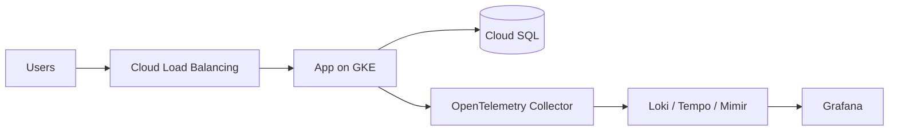

<!--
Recruiter-Friendly-README-Template | README.md | Version 2.0.0 | 2026-10-20
Keep this line when you copy the template: it records which template version a project README was built from.
See CHANGELOG.md in the template repo for what changed between versions.

HOW TO USE THIS TEMPLATE
Copy this file into a project repo as README.md and replace everything in [square brackets].
Text inside these comment markers is guidance only. It does not show on GitHub, and the portfolio site
removes it during the build, so it is safe to leave in.

Before you start:
a. Only feature finished projects. A featured project marked "in progress" weakens the page.
b. Deploy once using small or dev-sized resources and confirm it works.
c. While it is running: record your measurements, capture 2-3 screenshots into docs/screenshots/,
   and deliberately break one component to test your failure handling (section 5).
d. Tear the infrastructure down to avoid charges.
e. Copy docs/templates/infra-checks.yml into .github/workflows/ so the status badge below is real.
f. On GitHub, set the repo description (used as the portfolio card summary) and topics (used as its tool tags).

Who reads what:
a. Recruiters read the top block (title through the summary table) and match keywords. Make it count.
b. Hiring managers read Summary, Requirements, Decisions, and Operations to judge your thinking.
c. Technical reviewers check Results, Security, the badge, and whether How to Run It actually works.
-->

# [Project Title]

> [One sentence: what it does and for whom. Example: "Centralized logs, metrics, and traces for a multi-service app on GKE, built with Terraform and the Grafana LGTM stack."]

[](https://github.com/techric/[repo-name]/actions/workflows/infra-checks.yml)

**Highlight:** [The single strongest measured result. Example: "Recovered from a full node pool failure in 4 minutes with no lost telemetry, verified by a controlled failover test."]

| | |
|---|---|
| **Stack** | [Example: Google Cloud (GKE, Cloud Storage, IAM), Terraform, Argo CD, OpenTelemetry, Grafana, Loki, Tempo, Mimir] |
| **Scope** | [Pick one: Solo lab build / Team project at an employer (details anonymized) / Personal tool in daily use] |
| **My role** | [What you personally did. Example: "Sole designer and builder: architecture, Terraform modules, pipeline, dashboards."] |
| **Last tested** | [Month Year] |

---

## 1. Summary

**a. Problem:** [The situation and why it matters, in one or two sentences.]

**b. Solution:** [What you built, in one or two sentences.]

**c. Result:** [The measured outcome, with a number and how you measured it.]

---

## 2. Requirements and Constraints

<!--
Decisions only make sense against the constraints that drove them. List the real ones,
even for a lab: budget ceiling, uptime target, scale, data rules, time available.
-->

| Requirement or constraint | Target |
|---|---|
| [Example: Monthly budget while running] | [Under $X] |
| [Example: Survive loss of one zone] | [Yes, with no manual steps] |
| [Example: No long-lived credentials] | [Workload identity only] |
| [Requirement] | [Target] |

---

## 3. Architecture

<!--
Replace the example diagram with your own and name the actual cloud services.
Mermaid is preferred: it renders on GitHub and on the portfolio site and follows light/dark mode.
To use an image instead, save it as docs/architecture.png and replace the code block with:

-->



**How it works:**

1. [Step one of the request or data flow.]
2. [Step two.]
3. [Step three.]

---

## 4. Key Decisions and Trade-offs

<!--
The section senior reviewers read most closely. Pick the 2-4 decisions that shaped the design,
and tie each one back to a requirement in section 2 where you can.
-->

| Decision | Options considered | Choice and why | Trade-off accepted |
|---|---|---|---|
| [Example: Compute platform] | [GKE, Cloud Run, Compute Engine] | [GKE: needed sidecars and a long-running collector] | [More operational overhead than Cloud Run] |
| [Example: Terraform state] | [Local file, Cloud Storage with locking] | [Cloud Storage: safe for CI and team use] | [One extra bootstrap step] |
| [Decision] | [Options] | [Choice and why] | [Trade-off] |

**What I would do differently:** [One or two honest sentences on what you would change with hindsight.]

---

## 5. Operations

**a. Monitoring and alerting:** [What you watch and what triggers an alert. Example: "Alerts on error rate above 2% for 5 minutes and on collector queue backlog; dashboards for latency by service."]

**b. Failure handling:**

<!--
Test at least one row for real and say so. A tested failure is far more convincing than a planned one.
-->

| Failure | What happens | How it recovers | Tested? |
|---|---|---|---|
| [Example: A node fails] | [Pods reschedule to healthy nodes] | [Automatic, about 2 minutes] | [Yes, by draining a node] |
| [Example: Telemetry backend unavailable] | [Collector buffers data] | [Automatic replay when backend returns] | [No, by design only] |
| [Failure] | [What happens] | [How it recovers] | [Yes / No] |

**c. Runbook:** [Link to docs/runbook.md if you wrote one, or remove this line.]

---

## 6. Results and Proof of Work

**a. Measured results**

<!--
Only report numbers you actually measured, and say how. Reviewers discount round numbers with no method.
If there is no real "before," report absolute results instead: load test throughput, latency at p95,
failover recovery time, cost per day from the billing export, or an Infracost estimate.
-->

| Metric | Result | How measured |
|---|---|---|
| [Example: p95 latency at 200 requests per second] | [180 ms] | [k6 load test, 10 minutes] |
| [Example: Recovery from zone loss] | [4 min] | [Controlled failover test] |
| [Example: Cost while running] | [$X per day] | [Cloud billing export] |

**b. Screenshots**

<!--
Add 2-3 screenshots to docs/screenshots/, then move the matching lines out of this comment.
They stay inside the comment until the files exist, so missing images never show as broken links.


-->

[One-line caption for each screenshot once added.]

**c. Command output**

```text
[Paste a short, relevant excerpt. Example:]
Apply complete! Resources: 12 added, 0 changed, 0 destroyed.
```

**d. Automated checks:** Every push runs terraform fmt, terraform validate, TFLint, and a Checkov policy scan. Current status is shown by the badge at the top.

---

## 7. Security

**a. Identity and access:** [Example: "Each service has its own service account with only the roles it needs; no project-wide Owner or Editor roles."]

**b. Credentials:** [Example: "No long-lived keys. CI authenticates with workload identity federation; workloads use GKE Workload Identity."]

**c. Secrets:** [Example: "Stored in Secret Manager, never in code or Terraform state."]

**d. Network exposure:** [Example: "Only the load balancer is public; nodes and the database have private addresses only."]

**e. State and data:** [Example: "Terraform state in a private, versioned bucket with encryption at rest."]

See the [Security Policy](SECURITY.md) and [Security Checklist](docs/security-checklist.md).

---

## 8. Cost

**a. Estimated cost:** [Example: "About $X per day while running, $0 after teardown."]

**b. How estimated:** [Example: "Infracost estimate, confirmed against the billing export after a 24-hour run."]

**c. Teardown:** This project is deployed on demand and destroyed after testing. [List anything that keeps billing after teardown, such as the state bucket.]

---

## 9. Production Readiness

<!--
Shows you know the difference between a working build and a production system.
Be specific; this is where lab projects earn senior-level credibility.
-->

| Area | This project | What production would need |
|---|---|---|
| [Example: Availability] | [Single region, multi-zone] | [Multi-region failover with tested recovery] |
| [Example: Backups] | [None] | [Automated backups with restore tests] |
| [Example: Service level objectives] | [Dashboards only] | [Defined SLOs with error budgets and paging] |
| [Area] | [Current] | [Needed] |

---

## 10. How to Run It

**a. Prerequisites:** [Example: Terraform 1.7+, Google provider 5.x (pinned in versions.tf), gcloud CLI, a Google Cloud project with billing enabled.]

**b. Deploy:**

```bash
git clone https://github.com/techric/[repo-name].git
cd [repo-name]/infra
cp terraform.tfvars.example terraform.tfvars   # then set your project ID
terraform init
terraform apply
```

**c. Verify:** [How to confirm it works. Example: "Open the Grafana URL from the Terraform output and check the Services dashboard."]

**d. Tear down:**

```bash
terraform destroy
```

---

## 11. Repo Structure

```text
infra/              Terraform code
docs/               Architecture diagram, screenshots, runbook, security checklist
scripts/            Helper scripts
.github/workflows/  Automated checks
README.md           This case study
SECURITY.md         Security policy
CONTRIBUTING.md     Contribution rules
```

---

## Author

[Your Name], cloud infrastructure engineer.
[Portfolio](https://techric.github.io) · [LinkedIn](https://www.linkedin.com/in/[your-handle]) · [GitHub](https://github.com/techric)
