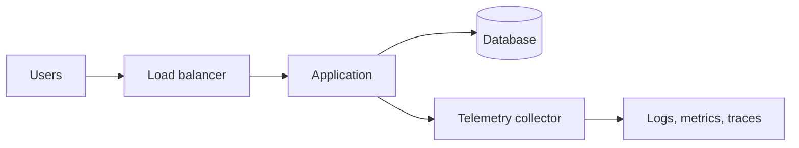

<!--
HOW TO USE THIS TEMPLATE
Copy this file into a project repo as README.md and replace everything in [square brackets].
Text inside these comment markers is guidance only. It does not show on GitHub or on the portfolio site,
so it is safe to leave in, but you can delete it once the section is filled in.

Workflow:
a. Deploy once using small or dev-sized resources and confirm it works.
b. Capture 2-3 screenshots and save them in docs/screenshots/.
c. Record before/after numbers for the Results section while the environment is up.
d. Tear the infrastructure down to avoid charges (for example, terraform destroy).
e. Fill in every section below. Keep each one short; reviewers skim.

Portfolio site notes:
a. The first "# Title" line is used as the page title; the site shows it in the page header.
b. The repo description on GitHub becomes the project card summary, and the repo topics become its tool tags. Set both.
c. Mermaid diagrams render on GitHub and on the site, and follow light/dark mode.
-->

# [Project Title]

> [One sentence: what this project does and who it is for. Example: "Centralized logging and tracing for a multi-service app on GKE, built with Terraform and the Grafana LGTM stack."]

| Cloud | Status | Time to deploy | Cost to run |
|---|---|---|---|
| [AWS / Google Cloud] | [Complete / In progress] | [~X minutes] | [~$X per day while running] |

---

## 1. Summary

**a. Problem:** [The situation and why it matters, in one or two sentences. Example: "Teams had no shared view of logs and traces, so incidents took hours to trace across services."]

**b. Solution:** [What you built, in one or two sentences. Example: "Deployed Loki, Tempo, and Mimir on GKE with Terraform, with OpenTelemetry collectors on every service."]

**c. Result:** [The measured outcome. Use a number wherever you have one. Example: "Time to locate the failing service dropped from about 45 minutes to under 5."]

---

## 2. Architecture

<!--
Replace the example diagram below with your own. Mermaid is preferred because it renders on GitHub and on the site
and is easy to update. To use an image instead, save it as docs/architecture.png and replace the code block with:

-->



**How it works:**

1. [Step one of the request or data flow.]
2. [Step two.]
3. [Step three.]

---

## 3. Key Decisions and Trade-offs

<!--
This is the section senior reviewers read most closely. Pick the 2-4 decisions that shaped the design.
For each, name the options you seriously considered, what you chose, why, and what you gave up.
-->

| Decision | Options considered | Choice | Why | Trade-off accepted |
|---|---|---|---|---|
| [Example: Compute platform] | [GKE, Cloud Run, Compute Engine VMs] | [GKE] | [Needed sidecars and a long-running collector] | [More operational overhead than Cloud Run] |
| [Example: State storage] | [Local state, GCS bucket with locking] | [GCS bucket] | [Safe for team use and CI pipelines] | [One extra bootstrap step] |
| [Decision] | [Options] | [Choice] | [Why] | [Trade-off] |

**What I would do differently:** [One or two honest sentences on what you would change with hindsight, more time, or a production budget.]

---

## 4. Results and Proof of Work

**a. Measured results**

| Metric | Before | After |
|---|---|---|
| [Example: Time to find failing service] | [~45 min] | [<5 min] |
| [Example: Monthly cost] | [$X] | [$Y] |
| [Metric] | [Value] | [Value] |

**b. Screenshots**

<!--
Add 2-3 screenshots to docs/screenshots/, then move the matching lines below out of this comment.
They are kept inside the comment so that missing images never show as broken links.


-->

[Short caption for each screenshot once added.]

**c. Command output**

```text
[Paste a short, relevant excerpt. Example:]
Apply complete! Resources: 12 added, 0 changed, 0 destroyed.
```

---

## 5. How to Run It

**a. Prerequisites:** [Example: Terraform 1.7+, gcloud CLI, a Google Cloud project with billing enabled.]

**b. Deploy:**

```bash
[git clone https://github.com/techric/your-repo.git]
[cd your-repo/infra]
[terraform init]
[terraform apply]
```

**c. Verify:** [How to confirm it works. Example: open the Grafana URL from the Terraform output and check the "Services" dashboard.]

**d. Tear down:**

```bash
[terraform destroy]
```

---

## 6. Tech Used

| Area | Tools |
|---|---|
| [Cloud] | [Example: Google Cloud (GKE, Cloud Storage, IAM)] |
| [Infrastructure as code] | [Example: Terraform, Terragrunt] |
| [Delivery] | [Example: GitHub Actions, Argo CD] |
| [Observability] | [Example: OpenTelemetry, Grafana, Loki, Tempo, Mimir] |

---

## 7. Security and Cost

**a. Security:** [One or two sentences on how access, secrets, and network exposure are handled.] See the [Security Policy](SECURITY.md) and [Security Checklist](docs/security-checklist.md).

**b. Cost:** This project is deployed on demand and torn down after testing to avoid ongoing charges. [Add the estimated cost per run, and any services that keep billing after teardown.]

---

## 8. Repo Structure

```text
infra/            Terraform code
docs/             Architecture diagrams, screenshots, security checklist
scripts/          Helper scripts
README.md         This case study
SECURITY.md       Security policy
CONTRIBUTING.md   Contribution rules
```

---

## Author

Built by [Techric](https://github.com/techric), a cloud engineer focused on secure, automated, and observable infrastructure on AWS and Google Cloud.
