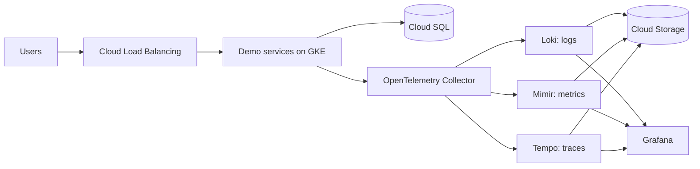

<!--
Recruiter-Friendly-README-Template | example-case-study.md | Version 1.0.0 | 2026-10-20
Built from README.md template version 2.1.0.
-->

> **This is a made-up example.** It shows what a finished README looks like when every section of the template is filled in. The project, person, and numbers are invented for illustration, and the badge and links do not point to a real repository. Use it as a model for the level of detail, tone, and length, not as content to copy.

---

# Observability Platform on GKE

> Centralized logs, metrics, and traces for a multi-service app on Google Kubernetes Engine (GKE), built with Terraform and the Grafana LGTM stack (Loki, Grafana, Tempo, Mimir).

[](https://github.com/example-user/gke-observability-platform/actions/workflows/infra-checks.yml)

**Highlight:** Recovered from the loss of a full node pool in 4 minutes with no lost telemetry, confirmed by a controlled failure test.

| | |
|---|---|
| **Stack** | Google Cloud (GKE, Cloud Storage, Cloud SQL, IAM), Terraform, Argo CD, OpenTelemetry, Grafana, Loki, Tempo, Mimir |
| **Scope** | Solo lab build |
| **My role** | Sole designer and builder: architecture, Terraform modules, deployment pipeline, dashboards, and failure testing |
| **Last tested** | October 2026 |

---

## 1. Summary

**a. Problem:** A demo app made of five small services had logs, metrics, and traces scattered across separate tools. Finding which service caused an error meant checking each one by hand.

**b. Solution:** Built a single observability platform on GKE. Every service sends its telemetry through OpenTelemetry collectors into Loki, Mimir, and Tempo, and Grafana shows all three in one place, linked together.

**c. Result:** Across 10 practice outages, the time to identify the failing service dropped from an average of 27 minutes to under 4 minutes.

---

## 2. Requirements and Constraints

| Requirement or constraint | Target |
|---|---|
| Monthly budget while running | Under $150 |
| Survive the loss of one zone | Yes, with no manual steps |
| No long-lived credentials | Workload identity only, no key files |
| Keep telemetry after a restart | 14 days of logs and traces, 30 days of metrics |
| Everything defined as code | 100% Terraform and Git, no manual console changes |

---

## 3. Architecture



**How it works:**

1. Users reach the demo services through Cloud Load Balancing.
2. Each service sends logs, metrics, and traces to an OpenTelemetry Collector running on every node.
3. The collector routes each type of data to its backend: Loki for logs, Mimir for metrics, and Tempo for traces.
4. All three backends store their data in Cloud Storage, so nothing is lost if a pod restarts.
5. Grafana reads from all three and links them, so an engineer can jump from an error log straight to the matching trace.

---

## 4. Key Decisions and Trade-offs

| Decision | Options considered | Choice and why | Trade-off accepted |
|---|---|---|---|
| Compute platform | GKE, Cloud Run, Compute Engine VMs | GKE: the collector needs to run on every node, which Cloud Run does not support | More to operate than Cloud Run, including node upgrades |
| Telemetry storage | Local disks, Cloud Storage | Cloud Storage: meets the retention requirement and survives pod and zone loss | Slightly slower queries on older data |
| Deployment method | Terraform only, Terraform plus Argo CD | Terraform for cloud resources, Argo CD for apps: Git becomes the single source of truth for both | One more tool to learn and run |
| Collector layout | One central collector, one per node | One per node: no single point of failure, which the zone-loss requirement needs | Uses more total memory across the cluster |

**What I would do differently:** I would set up Grafana alert rules in Terraform from the start. I added them by hand first and then had to rebuild them as code, which took an extra day.

---

## 5. Operations

**a. Monitoring and alerting:** Alerts fire when any service's error rate stays above 2% for 5 minutes, when a collector's queue backs up for more than 2 minutes, and when storage writes fail. A "Services" dashboard shows request rate, errors, and response time for each service.

**b. Failure handling:**

| Failure | What happens | How it recovers | Tested? |
|---|---|---|---|
| A whole node pool is lost | Pods move to the remaining zone; collectors hold data in memory while they restart | Automatic, about 4 minutes | Yes, by deleting the node pool during a load test |
| Loki is unavailable | Collectors buffer logs for up to 10 minutes | Automatic replay when Loki returns | Yes, by scaling Loki to zero for 5 minutes |
| Cloud SQL fails over to its standby | The demo services retry their connections | Automatic, under 60 seconds | No, by design only |

**c. Runbook:** [docs/runbook.md](docs/runbook.md) covers the five most likely problems and how to fix each one.

---

## 6. Results and Proof of Work

**a. Measured results**

| Metric | Result | How measured |
|---|---|---|
| Time to identify the failing service | 27 min before, under 4 min after | Average across 10 practice outages, timed with a stopwatch |
| Recovery from node pool loss | 4 min, with no lost telemetry | Controlled failure test during a k6 load test |
| Response time at 200 requests per second (95th percentile) | 180 ms | k6 load test, 10 minutes |
| Cost while running | $4.20 per day | Cloud billing export over a 72-hour run |

**b. Screenshots**


The first screenshot shows the cluster spread across two zones. The second shows the Services dashboard during a load test, with one service's errors rising. The third shows Argo CD with every app in sync with Git.

**c. Command output**

```text
Apply complete! Resources: 47 added, 0 changed, 0 destroyed.

Outputs:
grafana_url = "https://grafana.example.internal"
cluster_name = "observability-lab"
```

**d. Automated checks:** Every push runs terraform fmt, terraform validate, TFLint, and a Checkov policy scan. Current status is shown by the badge at the top.

---

## 7. Security

**a. Identity and access:** Each component has its own service account with only the roles it needs. No account has project-wide Owner or Editor roles.

**b. Credentials:** No long-lived keys. The deployment pipeline signs in with workload identity federation, and workloads use GKE Workload Identity.

**c. Secrets:** The Grafana admin password and database credentials are stored in Secret Manager and never appear in code or Terraform state.

**d. Network exposure:** Only the load balancer is public. Nodes and the database have private addresses only, and Grafana is reached through Identity-Aware Proxy.

**e. State and data:** Terraform state is in a private, versioned Cloud Storage bucket with encryption at rest. Checkov flags one deliberate exception: telemetry buckets do not use customer-managed encryption keys, to stay within budget. Google-managed encryption is still on.

See the [Security Policy](SECURITY.md) and [Security Checklist](docs/security-checklist.md).

---

## 8. Cost

**a. Estimated cost:** About $4.20 per day while running, and about $0.10 per month after teardown.

**b. How estimated:** Infracost estimate before deploying, confirmed against the Cloud billing export after a 72-hour run.

**c. Teardown:** This project is deployed on demand and destroyed after testing. The Terraform state bucket remains after teardown, which accounts for the $0.10 per month.

---

## 9. Production Readiness

| Area | This project | What production would need |
|---|---|---|
| Availability | One region, two zones | Two regions with tested failover |
| Backups | Telemetry stored in Cloud Storage; no backup of Grafana settings | Automated backups of Grafana settings, with regular restore tests |
| Service level objectives | Dashboards and alerts only | Defined service level objectives with error budgets and on-call paging |
| Access | One admin account | Single sign-on with role-based access for each team |
| Scale | Tested to 200 requests per second | Load tests at 10 times expected peak traffic |

---

## 10. How to Run It

**a. Prerequisites:** Terraform 1.7 or later, Google provider 5.x (pinned in versions.tf), the gcloud command-line tool, kubectl, and a Google Cloud project with billing enabled.

**b. Deploy:**

```bash
git clone https://github.com/example-user/gke-observability-platform.git
cd gke-observability-platform/infra
cp terraform.tfvars.example terraform.tfvars   # then set your project ID
terraform init
terraform apply
```

**c. Verify:** Open the `grafana_url` from the Terraform output, sign in through Identity-Aware Proxy, and open the Services dashboard. All five services should show traffic within 2 minutes.

**d. Tear down:**

```bash
terraform destroy
```

---

## 11. Repo Structure

```text
infra/              Terraform code for the cluster, storage, database, and access
apps/               Argo CD application definitions
dashboards/         Grafana dashboards as JSON
docs/               Architecture notes, screenshots, runbook, security checklist
.github/workflows/  Automated checks
README.md           This case study
SECURITY.md         Security policy
CONTRIBUTING.md     Contribution rules
```

---

## Author

Alex Rivera (example person), cloud infrastructure engineer.
[Portfolio](https://example.com) · [LinkedIn](https://www.linkedin.com/in/example) · [GitHub](https://github.com/example-user)
